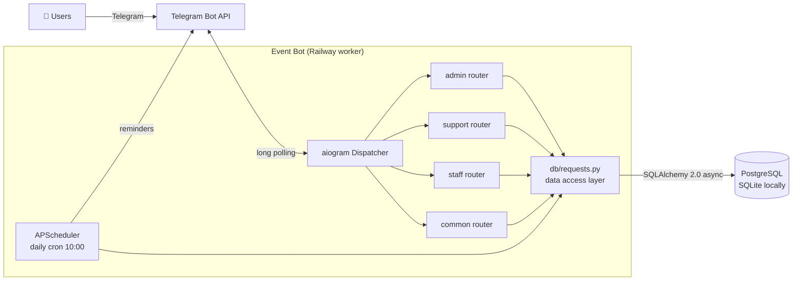
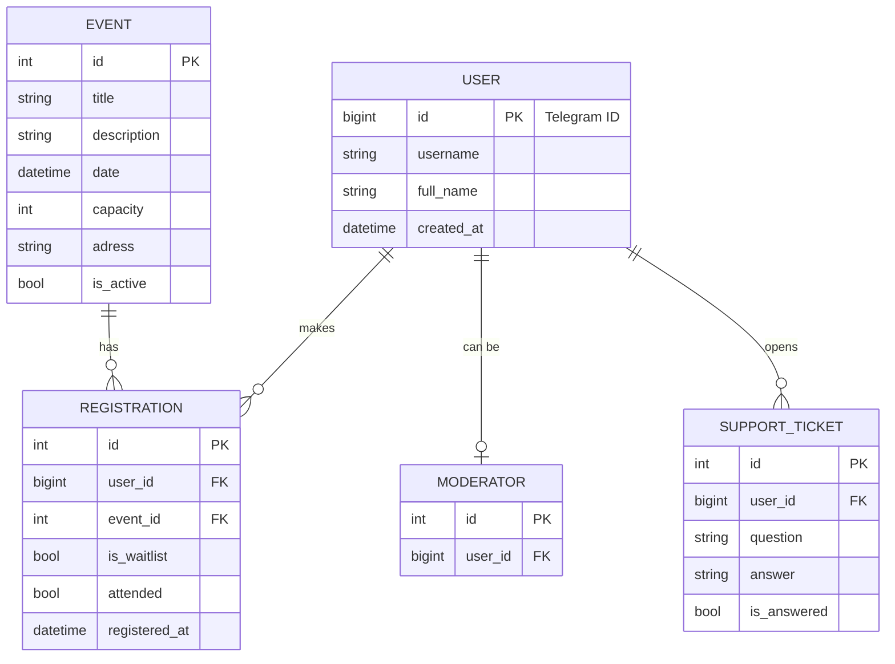
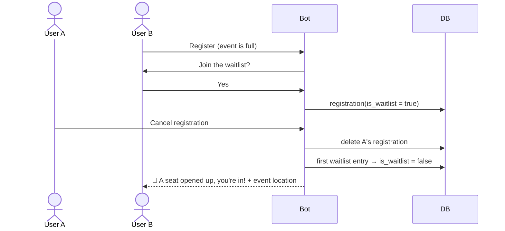

<div align="center">

# 🎫 Telegram Event Bot

**Telegram bot for event registration, waitlists, reminders and attendance tracking**

Available in English and Ukrainian

In production at a Ukrainian student organization in Austria: **500+ users · 25 events · 800+ registrations**


</div>

---

## 📌 About

The bot was built for a student organization of Ukrainian students in Austria that runs regular offline
events. It replaced the Google Forms workflow they used before: everything now happens inside
Telegram. Participants sign up, organizers manage events, and moderators check people in at the door.

**The problem:** Google Forms has no seat limits, no waitlist and no reminders. Events have ~25 seats,
people registered and then didn't show up (only **~60%** attendance), questions piled up in personal
messages, and nobody knew who had actually attended.

**The solution:** one bot with three roles, a capacity-aware registration flow with an automatic
waitlist, scheduled reminders, a support ticket system, and attendance statistics.
Attendance went up from **~60% to ~95%**.

Designed, built, deployed and maintained by a single developer.

## ✨ Features

### 👤 Participants
- **Onboarding**: name collection on first `/start`
- **Upcoming events**: description, date and number of free seats
- **One-tap registration / cancellation** with inline buttons
- **Waitlist**: when an event is full, the user can join a FIFO queue
- **Automatic promotion**: when someone cancels, the first person in the waitlist gets the seat and a notification
- **Reminders** 3 days and 1 day before the event, with a confirm / cancel button
- **Private event location**: the address is only revealed after registration
- **Support**: ask a question and get the answer back in the same chat

### 👮 Moderators (`/mod`)
- All registrations per event, including waitlist status
- **Attendance check-in** at the door: ✅ came / ❌ didn't come, toggled inline
- Receive support tickets and answer them; the bot prevents a ticket from being answered twice

### 🛠 Admins (`/admin`)
- Create events step by step (title → description → capacity → address → date)
- Manage events: change capacity, title or description; close or delete an event
- **Broadcast** a message to every confirmed participant of an event
- Add and remove moderators (`/addmod`, `/removemod`)
- **Analytics**:
  - global: total users, registrations, registrations in the last 30 days, attendance
  - per event: registered vs attended vs capacity
  - most active users leaderboard (top 100)
  - personal history of any user (`/userstat @username`)

## 🏗 Architecture



- **Routers by role.** Admin, support, staff and user handlers live in separate aiogram
  routers. The admin router is protected by a filter on `ADMIN_IDS`, and moderator access is
  checked against the database.
- **FSM for multi-step flows.** Event creation, event editing, support questions and answers
  are built on aiogram finite state machines.
- **Data access layer.** All SQL lives in `db/requests.py`; handlers never build queries themselves.
- **Async end to end.** aiogram + SQLAlchemy async + asyncpg, with connection pooling and `pool_pre_ping`.
- **Same code, two databases.** SQLite for local development, PostgreSQL in production. The
  `DATABASE_URL` from Railway is normalised to the `asyncpg` driver automatically.
- **Localization.** All user-facing texts live in `locales/` (English and Ukrainian); the language
  is chosen with `BOT_LANG`.
- **Telegram rate limits.** Broadcasts and reminders are throttled to stay below Telegram's flood limits.

## 🗄 Data model



## 🔄 Registration and waitlist flow



## 📂 Project structure

```
telegram-event-bot/
├── bot.py              # entry point: DB init, routers, scheduler, polling
├── config.py           # environment config (token, admin IDs)
├── scheduler.py        # APScheduler jobs: reminders 3 days and 1 day before an event
├── messages.py         # loads the texts for BOT_LANG
├── locales/
│   ├── en.py           # English texts
│   └── uk.py           # Ukrainian texts
├── db/
│   ├── base.py         # async engine, session factory, Postgres/SQLite switch
│   ├── models.py       # SQLAlchemy 2.0 models
│   └── requests.py     # data access layer: all queries and statistics
├── handlers/
│   ├── common.py       # onboarding, events, registration, waitlist
│   ├── admin.py        # event CRUD, broadcasts, moderators, analytics
│   ├── staff.py        # registrations list and attendance check-in
│   └── support.py      # support tickets: question → moderators → answer
├── keyboards/
│   ├── reply.py        # role-based menus
│   └── inline.py       # registration, waitlist, attendance buttons
├── .env.example        # environment variables template
├── Procfile            # Railway worker
└── requirements.txt
```

## 🚀 Getting started

```bash
git clone https://github.com/msydrv/telegram-event-bot.git
cd telegram-event-bot
python -m venv .venv && source .venv/bin/activate
pip install -r requirements.txt
```

Create a `.env` file from the template:

```bash
cp .env.example .env
```

| Variable | Description |
|---|---|
| `BOT_TOKEN` | bot token from [@BotFather](https://t.me/BotFather) |
| `ADMIN_IDS` | Telegram IDs of admins, comma-separated |
| `DATABASE_URL` | optional PostgreSQL URL; SQLite is used if not set |
| `BOT_LANG` | `en` (default) or `uk` |

Run:

```bash
python bot.py
```

Tables are created automatically on first start.

### Deployment

The bot runs as a **worker** process on [Railway](https://railway.app) (see `Procfile`) with a managed
PostgreSQL database. Railway provides `DATABASE_URL`, and the bot converts it to the async driver.

## 📈 In production

| Metric | Value |
|---|---|
| 👥 Users | **500+** |
| 🎉 Events held | **25** |
| 📋 Registrations | **800+** |
| 🎯 Attendance rate | **~60% → ~95%** after reminders and check-in |
| ⏳ Waitlist | up to **~10 people per event** moved to a confirmed seat automatically (typical capacity: 25) |
| ⚡ Peak load | **30 registrations in 5 minutes** after an announcement |
| 💬 Support tickets | **130** answered by 2 moderators |
| 🗓 In production since | March 2026 |
| 🧑‍💻 Team | solo developer |

Most features (waitlist, attendance, analytics, broadcasts, double-answer protection for tickets) were added
after launch, in response to real problems the organizers ran into.

## 🗺 Roadmap

- [ ] Alembic migrations
- [ ] Unique constraint and row locking to make registration safe under concurrent clicks
- [ ] Automatic promotion from the waitlist when capacity is increased
- [ ] Auto-close events after their date
- [ ] Timezone-aware scheduling (Europe/Kyiv)
- [ ] Tests (pytest + pytest-asyncio) and CI
- [ ] Docker image
- [ ] Language selection per user instead of per bot

## 👨‍💻 Author

[GitHub @msydrv](https://github.com/msydrv)
